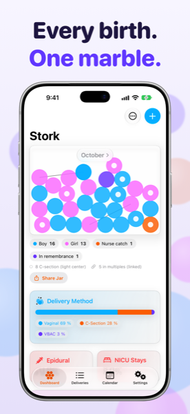
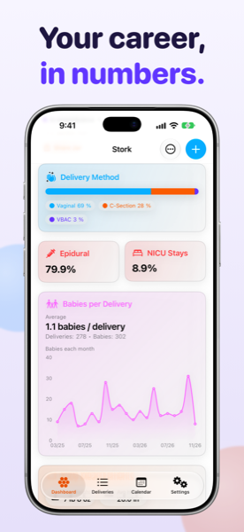
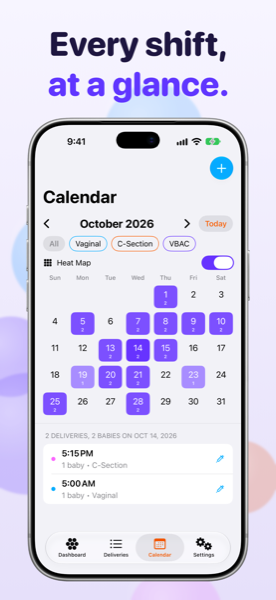
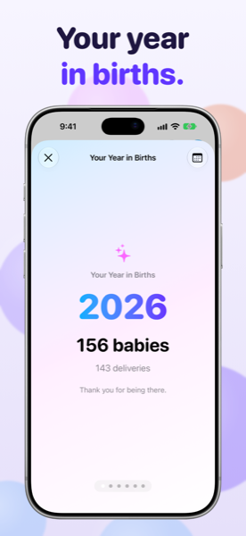

<p align="center">
  
</p>

<h1 align="center">Stork</h1>

<p align="center"><strong>Track the deliveries you perform, visualize trends, and celebrate every birth.</strong></p>

<p align="center">
  <a href="https://apps.apple.com/us/app/stork-l-d-companion/id6740038476">App Store</a> &middot;
  <a href="https://farsidesoftware.com/stork">Product page</a> &middot;
  <a href="https://farsidesoftware.com/support">Support</a> &middot;
  <a href="https://farsidesoftware.com/privacy">Privacy policy</a>
</p>

<p align="center">
  
  
  
  
</p>

Stork is a private logbook for Labor and Delivery nurses, midwives, and OB-GYNs. Log each delivery in seconds, watch your career take shape, and keep your data in your own iCloud. This repository is the current codebase, which is Stork 4.0.

## What it does

- **Delivery log.** Record method, epidural use, NICU stays, nurse catches, tags, and notes, with one or more babies per delivery, and back-date any entry. Search and filter by notes, tags, method, and date.
- **Delivery Jar.** Each delivery adds a marble to an interactive SpriteKit jar that reacts to device tilt.
- **Dashboard.** Delivery counts, methods, time-of-day and day-of-week patterns, year-over-year growth, and personal bests, with a calendar and heat map.
- **Your Year in Births.** A year-end recap you can share.
- **Career milestones.** Milestone detection and shareable milestone cards.
- **Export.** PDF reports and CSV, per delivery or per baby, with metric or imperial units.
- **Across your devices.** An Apple Watch app, widgets, Siri and Shortcuts, Spotlight, and iCloud sync.
- **iPhone Duo.** Unfolded, Stork uses both screens: the jar beside your stats, the list beside the detail, and the calendar beside the chosen day.

Logging and your stats are free. Stork Pro is a one-time purchase that unlocks milestone and jar sharing, PDF and CSV export, insight cards and the heat map, weather at each delivery, and Lock Screen widgets. Stork is available in English, Spanish, Canadian French, and Japanese.

## Platforms and requirements

- iPhone and iPad (iOS 26 or later) and Apple Watch (watchOS 26.2 or later). It also runs on Mac and Apple Vision as a compatible iPad app.
- To build: Xcode 27 and an Apple Developer account for the CloudKit, HealthKit, and WeatherKit capabilities.

## Building

1. Clone the repository and open `Stork.xcworkspace`, not the bare `.xcodeproj`. It resolves the local package in `Packages/Stork`.
2. Set your signing team and update the bundle identifiers and the App Group and iCloud container identifiers.
3. Enable the capabilities: iCloud (CloudKit, private database), HealthKit, App Groups, WeatherKit, and Background Modes (remote notifications, for CloudKit sync).
4. The Stork Pro unlock is a non-consumable in-app purchase with Family Sharing. Add your own product identifier for it.
5. Build and run the `Stork` scheme.

Run the package tests, which need no simulator:

```sh
cd Packages/Stork && swift test
```

## Architecture

Stork is a thin app target on top of an SPM umbrella package of layered modules. Dependencies point inward: features depend on the design system and core, data implements core's protocols, and core depends on nothing.

```
Stork (app target, thin shell) · StorkWidgetsExtension · StorkWatch
    └── StorkComposition        SessionController (composition root) + RootView/MainView
            ├── StorkFeature*   Deliveries · Dashboard · Onboarding · Settings · Export
            ├── StorkServices   Weather, location, and health managers behind seams
            ├── StorkData       SwiftData repositories · CloudKit store · cloud sync
            ├── StorkDesignSystem  brand colors · glass · haptics · stat views
            └── StorkCore       models · statistics · protocols · navigation (pure)
```

- **Repositories and use-cases.** Views never touch SwiftData. Every read and write goes through a single-verb use-case with typed errors.
- **Observable view models over protocol seams.** Each feature screen has a cross-platform `@Observable` model, unit-tested on the Mac against in-memory fakes.
- **One change stream.** A multicast `AsyncStream` notifies every screen after each write, including CloudKit imports.

`CLAUDE.md` has the module-by-module detail.

## Privacy

Your data is stored in your private iCloud container. Stork is built so you never enter patient details or facility information, only your own stats. Location accuracy is limited, and there are no accounts, no analytics, and no tracking.

---

Made by [Farside Software LLC](https://farsidesoftware.com). Released under the MIT License, see [LICENSE](LICENSE).
